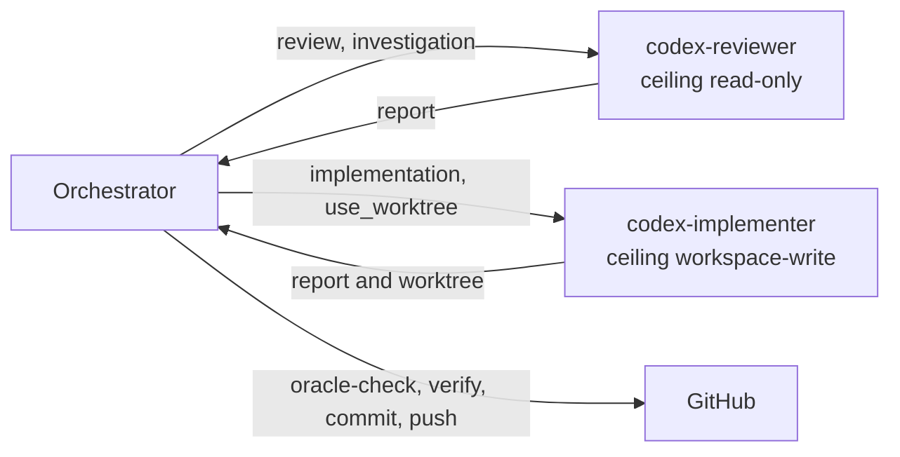

# 0014. Run Codex through two registrations named by role and install them from this repository

- Status: accepted
- Date: 2026-10-06
- Amends: [0011](0011-delegate-through-subagents-interchangeable-with-codex.md)

## Context

ADR 0011 makes Codex a delegate through `codex-subagent-mcp` and says `Implement: codex` and `Review: codex` choose it. Checked on 2026-10-06:

- The registration was made by hand in `~/.claude.json`, with the range `^0.3.0`. On a 0.x version a caret admits only the same minor, so it could not reach 0.4.0 or 0.5.0, the latest. `install.mjs --check` reported no drift because it does not look at MCP servers.
- Its ceiling was `CODEX_SUBAGENT_MAX_SANDBOX=read-only`, so `Implement: codex` could never write. The server sets that ceiling per process: no argument of a call can raise it.
- A Codex that only returns a diff does not replace an implementer. Under `read-only` the sandbox can deny commands that create temporary or build files, so the tests may not run (the server's own README says so), and the orchestrator would end up writing the code.
- Hooks are a Claude Code feature. `guard-tests` and `guard-git` do not see what Codex writes, so the frozen oracle is protected for a Codex implementer only by `oracle-check`.
- Read from `build/server.js` of 0.5.0: the description of every tool is a fixed string that does not depend on the configuration, the server sends no `instructions` when a client connects, and every instance introduces itself with the same server name. Two registrations of one package therefore expose the same eight tools with identical text, and the registered name is the only signal. Reported upstream as [parisbs/codex-subagent-mcp#143](https://github.com/parisbs/codex-subagent-mcp/issues/143).
- Since 0.5.0 a delegation inherits no MCP server, plugin or app of the user's Codex setup unless allowed, which matters because the sandbox does not confine those tools. This machine's `~/.codex/config.toml` has `node_repl` and browser and computer-use plugins.
- Exercised on 2026-10-06 through the real server 0.5.0 on a scratch repository ([probes](../experiments/2026-10-06-delegation-probes.md), one run each): the reviewer environment refused a `workspace-write` call and a read-only run could not create a file; the implementer environment with `use_worktree` left the edit in a worktree under `~/.codex/worktrees/` (a detached `HEAD` registered in the repository) and the original tree untouched, the diff applied cleanly to the original repository, the tests ran, and Codex could not commit (`index.lock: Operation not permitted`). The worktree had no `node_modules`, and Codex rewrote production code to remove the missing import and reported it. The worktree is made from the last commit: a tracked file modified and an untracked file in the original tree were not in it. It used 108,286 input tokens for a one-line change that took four commands, and 24,980 for an inspection of one command.

The orchestrator is the only node that talks to both delegates and to GitHub. The reviewer cannot write by construction, and the implementer writes only in a worktree that the orchestrator inspects before anything reaches the branch.

## Decision

- Codex runs through **two registrations** of `codex-subagent-mcp`, both in the user scope and on the same version range:
  - `codex-reviewer`: `CODEX_SUBAGENT_MAX_SANDBOX=read-only`. It serves reviews, investigations and second opinions.
  - `codex-implementer`: `CODEX_SUBAGENT_MAX_SANDBOX=workspace-write`. The orchestrator calls it with `sandbox: workspace-write` and `use_worktree: true`, never with `auto_approve`.
- Both set `CODEX_SUBAGENT_DEFAULT_MODEL`, `CODEX_SUBAGENT_DEFAULT_EFFORT=high`, `CODEX_SUBAGENT_MAX_EFFORT=high`, `CODEX_SUBAGENT_MCP_SERVERS=none`, `CODEX_SUBAGENT_PLUGINS=none` and `CODEX_SUBAGENT_APPS=off`, written out even though they are the defaults of 0.5.0. Neither sets `CODEX_SUBAGENT_DEFAULT_SANDBOX`, so a write is always an explicit argument that the permission prompt shows. `CODEX_BIN` comes from the local overlay, because it is a path of one machine.
- **Names follow `<engine>-<role>`**: `claude-implementer`, `claude-researcher`, `codex-implementer`, `codex-reviewer`; `claude-reviewer` stays deferred. A name says what the delegate is for.
- **The workflow routes by literal tool name, not by description.** Delegation and `pr-prep` name `mcp__codex-reviewer__codex_delegate` for `Review: codex` and `mcp__codex-implementer__codex_delegate` for `Implement: codex`.
- **The orchestrator commits before it delegates.** The worktree has the last commit and nothing else, so the oracle and every file the task needs are committed first.
- **The orchestrator integrates.** A Codex implementer leaves its work in the worktree; the orchestrator reads the diff, applies it to the work branch, runs `oracle-check` and the verify command, commits, pushes and removes the worktree with `git worktree remove`. No change from a Codex worktree reaches the branch before `oracle-check` is clean.
- **The package for `codex-implementer` says that the worktree holds only tracked files**, so dependencies and build output are missing, and that the delegate reports a missing dependency instead of changing production code to get around it. The orchestrator reads the diff for changes made to fit the environment.
- **The registrations are declared in this repository**: `global/mcp-servers.json` for the generic values and `personal/mcp-servers.json` for the machine's. `install.mjs` registers them through `claude mcp`, never by writing `~/.claude.json`, and `--check` reports drift, including a server that no longer ships. A new minor version of the package is a pull request, read against its changelog.
- **Permissions**: the tools that spend no quota (`codex_doctor`, `list_codex_models`, `codex_recommend` and the three job tools) of both servers are allowed in `global/settings.json`. `codex_delegate` and `codex_follow_up` ask every time. A repository that declares `Review: codex` may allow `codex_delegate` of `codex-reviewer` in its own `.claude/settings.json`, which is on the control plane and so merged by the human.

## Alternatives considered

- **Keep the manual registration.** Rejected: it already drifted, and the ceilings are a security control that nothing records or checks.
- **One registration with a `workspace-write` ceiling and a hook that validates write calls.** Rejected: the reviewer's inability to write would depend on a hook, which on this repository is a safety net for one machine and not a boundary (ADR 0002). It stays the fallback if two servers prove too costly.
- **A read-only Codex that returns a diff for the orchestrator to apply.** Rejected for the three reasons in Context: it cannot run the tests, the orchestrator ends up implementing, and a hand-written patch often does not apply.
- **Raise the ceiling per call.** Not possible: the server refuses it by design.
- **Keep the name `codex-subagent` for the reviewer.** Rejected: it says nothing about the role. Its cost is that `css-diagnostic` references `mcp__codex-subagent__*` in permissions, an agent, a skill and two records, and must migrate (issue 19).
- **Ship the servers in a plugin.** Not pursued: it needs a marketplace and a different install path for one dependency, and the drift check would not cover it. Not evaluated beyond that.
- **Wait for self-describing instances upstream before routing.** Rejected: routing by literal name works today, and the upstream issue only improves the case where the orchestrator chooses from descriptions alone.

## Consequences

- `Implement: codex` becomes possible, so the Phase 4 comparison of Claude and Codex implementers can run. In a repository whose tests need installed dependencies the worktree cannot run them, and the sandbox has no network: the delegate can report it, and the orchestrator runs the verify command in the real tree. Not checked: `auto_approve`, efforts above low, Linux and Windows.
- A Codex run costs far more input tokens than its task suggests (108,286 for a one-line change, with a floor near 25,000), and its worktrees accumulate until removed.
- `ROADMAP.md` says the ceiling is `read-only` on purpose. That holds for `codex-reviewer` only and the roadmap is updated with the work that follows this record.
- Reviews do not write, and an orchestrator that picks the wrong server for a write gets a refusal and spends one turn.
- A running session keeps the old process of a server until it reloads; replacing a registration briefly removes it.
- The hooks do not see Codex: the control for a Codex implementer is `oracle-check` and the orchestrator's review, and reads are not confined in any mode.
- The server's description still says "Set sandbox to workspace-write to let it edit files" on `codex-reviewer`; the refusal that follows is harmless. Upstream #143 removes it.
- `claude mcp` is the only writer of `~/.claude.json`; a server of the same name in the local or project scope shadows the user one, and the drift check reads the user scope only.
