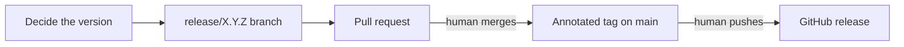

# Releasing

How a version of this repository is decided, prepared and published. The version policy and the public
interface are in [ADR 0031](adr/0031-version-releases-by-their-effect-on-the-public-interface.md); a release is
an annotated `vX.Y.Z` tag on `main` ([ADR 0005](adr/0005-conventional-commits-and-releases-from-tags.md)).
`/release-prep X.Y.Z` follows this document.

The flow: decide the version from the pull requests since the last tag, prepare it on a `release/X.Y.Z` branch,
merge that branch through a pull request, then tag the merge commit and publish. The human merges, pushes the
tag and publishes; the agent prepares each step and stops before it.

## 1. Decide the version

1. Update `main` and list what shipped since the last tag:
   `git describe --tags --abbrev=0 origin/main`, then `git log <tag>..origin/main --oneline`.
2. Classify each pull request as major, minor or patch against the public interface in ADR 0031. Read the diff
   when the subject does not settle it: a `fix` that changes a default is major. The release takes the highest
   class.
3. Before v1.0.0, a major-class change bumps the minor version and its changelog entry starts with **Breaking**.
4. A version the human asked for that disagrees with the classification is reported with the pull requests
   that decide it; the human chooses.

## 2. Prepare the release branch

From an updated `main`, create `release/X.Y.Z` and:

1. In `CHANGELOG.md`, add `## [X.Y.Z] - YYYY-MM-DD` above the previous version, compiled from the bodies of the
   pull requests from step 1; an Unreleased section, when there is one, becomes this section. Each section has:
   - one entry per pull request, its Conventional Commits subject followed by a link to the pull request;
   - **Breaking** before every major-class entry;
   - a "New tools" subsection naming each skill, agent, hook, script, stack, MCP registration or module added,
     or "None".
   Add a link reference for the version that compares it with the previous tag.
2. Align `README.md` and `docs/ROADMAP.md` with what ships. ADR statuses change only when the human has
   accepted or rejected a record.
3. This repository keeps no version string in files: `package.json` has none. Search for the previous version
   (`git grep -n 'X.Y.Z-previous'`) to catch a reference that should move.
4. Run `npm test`.

Commit as `chore(release): prepare X.Y.Z` and prepare the pull request with `/pr-prep`. Its body lists the
classification from step 1. The changelog changes only here.

## 3. Tag and publish

After the human merges the release pull request:

1. Update `main` and create the annotated tag on the merge commit with a one-line summary, as the existing tags
   do: `git tag -a vX.Y.Z -m "vX.Y.Z: 
"`.
2. Push it only when the human says so: `git push origin vX.Y.Z`.
3. Create the GitHub release from the tag with the changelog section as its notes:
   `gh release create vX.Y.Z --title vX.Y.Z --notes-file <section>`, when the human asks for it.
4. Delete `release/X.Y.Z` locally and on the remote.
5. Take the release locally with `node scripts/install.mjs`, then `node scripts/install.mjs --check`.

## Hotfixes

A fix that cannot wait for the next release goes through a `hotfix/<description>` branch from `main` and a pull
request, then is released as the next patch version by the same steps. Tags live on `main`, so a hotfix release
ships everything merged since the last tag: when that includes a minor-class or major-class change, the release
takes that class instead of a patch.
