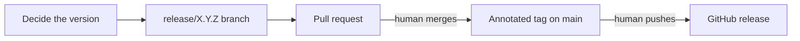

# Releasing

How a version of this repository is decided, prepared and published. The version policy and the public
interface are in [ADR 0031](adr/0031-version-releases-by-their-effect-on-the-public-interface.md); a release is
an annotated `vX.Y.Z` tag on `main` ([ADR 0005](adr/0005-conventional-commits-and-releases-from-tags.md)).
`/release-prep X.Y.Z` follows this document.

The flow: decide the version from what changed since the last tag, prepare it on a `release/X.Y.Z` branch,
merge that branch through a pull request, then tag the merge commit and publish. The agent prepares every step.
The human merges the release pull request, because it carries `needs-human`, and pushes the tag and publishes
the release, which global `CLAUDE.md` reserves to the human.



## 1. Decide the version

1. Update `main` and list what shipped since the last tag:
   `git describe --tags --abbrev=0 origin/main`, then `git log <tag>..origin/main --oneline`.
2. Classify each change as major, minor or patch against the public interface in ADR 0031, comparing with the
   previous tag rather than with the pull request's parent: a change to something added since that tag is not
   breaking. Read the diff when the subject does not settle it; a `fix` that changes a default is major. The
   release takes the highest class.
3. Before v1.0.0, a major-class change bumps the minor version and its changelog entry starts with **Breaking**.
4. A version the human asked for that disagrees with the classification is reported with the pull requests
   that decide it; the human chooses.

## 2. Prepare the release branch

From an updated `main`, create `release/X.Y.Z` and:

1. In `CHANGELOG.md`, write `## [X.Y.Z] - YYYY-MM-DD` above the previous version from the pull requests listed
   in step 1, using their bodies. An Unreleased section, when there is one, is replaced by this section, not
   reused as it is: it misses whatever merged after it was written. The section has:
   - one entry per pull request, its Conventional Commits subject followed by a link to the pull request;
   - **Breaking** before every major-class entry;
   - a "New tools" subsection naming each skill, agent, hook, script, stack, MCP registration, template or
     module added, or "None".
   Add a link reference that compares the version with the previous tag.
2. Align `README.md` and `docs/ROADMAP.md` with what ships. ADR statuses change only when the human has
   accepted or rejected a record.
3. No file holds the release version: `package.json` has none. Version strings that are not this release's,
   such as the pinned `codex-subagent-mcp@0.6.0` or the metrics `script_version`, stay as they are.
4. Run `npm test`.

Commit as `chore(release): prepare X.Y.Z`, prepare the pull request with `/pr-prep` and label it `needs-human`:
a release pull request that changes only the changelog, `README.md` and the roadmap touches no control-plane
path, so nothing else stops an orchestrator from merging it.
Its body lists the classification from step 1. The changelog changes only here.

## 3. Tag and publish

After the human merges the release pull request:

1. Update `main` and create the annotated tag on the merge commit with a one-line summary, as the existing tags
   do: `git tag -a vX.Y.Z -m "vX.Y.Z: <summary>"`.
2. Hand the human the commands that publish, and stop:
   - `git push origin vX.Y.Z`;
   - `gh release create vX.Y.Z --title vX.Y.Z --notes-file <the changelog section>`.
3. Once the tag is on the remote, delete `release/X.Y.Z` locally and on the remote.

The milestones of this repository group work by theme, not by version, so a release closes none.

## Hotfixes

A hotfix goes through a `hotfix/<description>` branch from `main` and a pull request, then is released as the
next patch version by the same steps. Tags live on `main`, so this works only while `main` holds nothing but
patch-class changes since the last tag; otherwise the fix ships in a regular release of the higher class.

## Installing a release

The version promise covers installs from a tag. To take a release:

```sh
git fetch --tags
git checkout vX.Y.Z
node scripts/install.mjs
node scripts/install.mjs --check
```

An install from `main` gets whatever has merged since the last tag.
